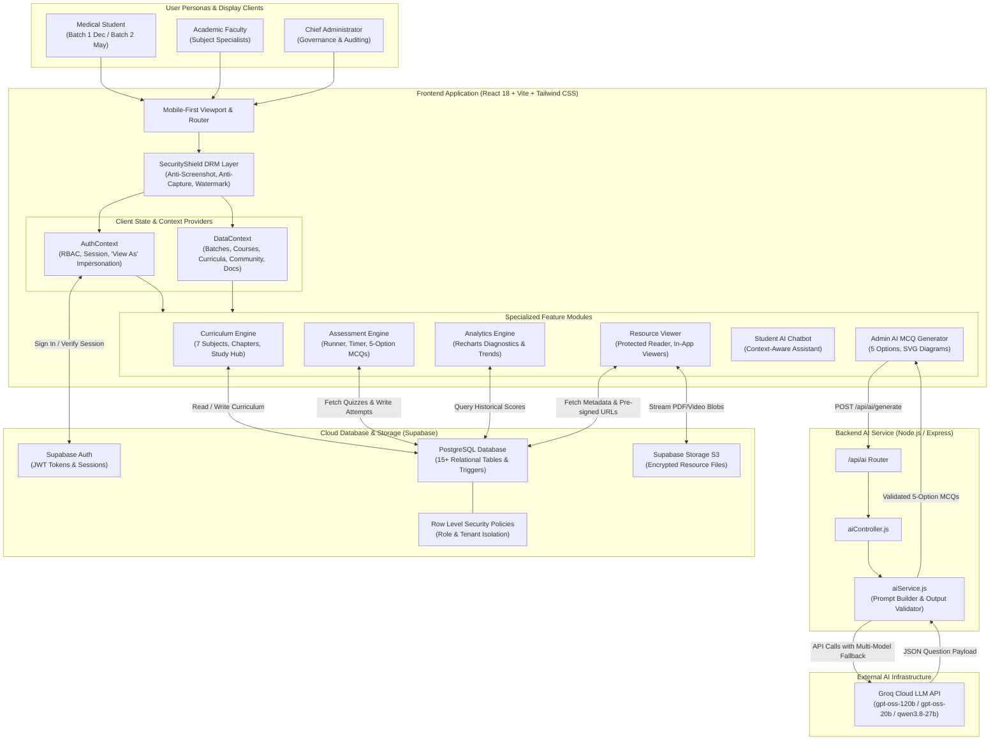
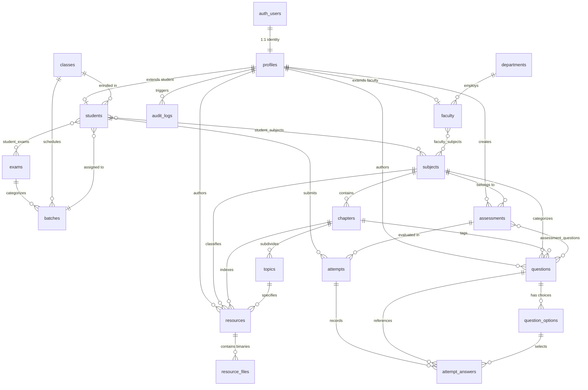

# Medical Competitive Examination Learning Management System (LMS)
## Master Project Overview, Architecture Specification & System Documentation

---

## Table of Contents
1. [Executive Summary & Project Idea](#1-executive-summary--project-idea)
2. [Functional Features Breakdown](#2-functional-features-breakdown)
   - 2.1 [Authentication, Role Hierarchy & Session Governance](#21-authentication-role-hierarchy--session-governance)
   - 2.2 [Curriculum Hierarchy & 7 Core Academic Subjects](#22-curriculum-hierarchy--7-core-academic-subjects)
   - 2.3 [Cohort Management & Strict Batch-Wise Isolation](#23-cohort-management--strict-batch-wise-isolation)
   - 2.4 [Learning Resources & Protected Content Delivery](#24-learning-resources--protected-content-delivery)
   - 2.5 [Unified Assessment & Testing Engine](#25-unified-assessment--testing-engine)
   - 2.6 [Attempt Lifecycle & Recharts Analytics](#26-attempt-lifecycle--recharts-analytics)
   - 2.7 [Dual AI Systems (Chatbot & MCQ Generator)](#27-dual-ai-systems-chatbot--mcq-generator)
   - 2.8 [Student Academic Documentation & Verification](#28-student-academic-documentation--verification)
   - 2.9 [Academic Calendar & Announcement Broadcasting](#29-academic-calendar--announcement-broadcasting)
   - 2.10 [Community Discussion Threads & Nested Replies](#210-community-discussion-threads--nested-replies)
   - 2.11 [Operational Administration & Audit Logging](#211-operational-administration--audit-logging)
3. [Non-Functional Features & Quality Attributes](#3-non-functional-features--quality-attributes)
   - 3.1 [Digital Rights Management (DRM) & Anti-Piracy Security](#31-digital-rights-management-drm--anti-piracy-security)
   - 3.2 [Row Level Security (RLS) & Database Authorization](#32-row-level-security-rls--database-authorization)
   - 3.3 [System Reliability & Dual-Mode Fallback Architecture](#33-system-reliability--dual-mode-fallback-architecture)
   - 3.4 [Performance, Latency & Asset Optimization](#34-performance-latency--asset-optimization)
   - 3.5 [Mobile-First Usability & Fullscreen Facility](#35-mobile-first-usability--fullscreen-facility)
4. [High-Level Architecture Diagram](#4-high-level-architecture-diagram)
5. [Low-Level Architecture Diagram](#5-low-level-architecture-diagram)
6. [Comprehensive User Use Cases](#6-comprehensive-user-use-cases)
   - 6.1 [Use Case 1: Aarav Patel (Medical Aspirant - Student Cohort)](#61-use-case-1-aarav-patel-medical-aspirant---student-cohort)
   - 6.2 [Use Case 2: Dr. Sunita Rao (Senior Faculty of Biology)](#62-use-case-2-dr-sunita-rao-senior-faculty-of-biology)
   - 6.3 [Use Case 3: Vikramaditya Singh (Chief Academic Administrator & Auditor)](#63-use-case-3-vikramaditya-singh-chief-academic-administrator--auditor)
7. [Database Schema & Data Model](#7-database-schema--data-model)
   - 7.1 [Entity Relationship Diagram (ERD)](#71-entity-relationship-diagram-erd)
   - 7.2 [Detailed Table Specifications & DDL](#72-detailed-table-specifications--ddl)
   - 7.3 [Automated Triggers & Stored Functions](#73-automated-triggers--stored-functions)
   - 7.4 [Indexing Strategy for High-Traffic Read Paths](#74-indexing-strategy-for-high-traffic-read-paths)
8. [Automated Verification & Test Harness](#8-automated-verification--test-harness)

---

# 1. Executive Summary & Project Idea

### The Problem
Medical competitive examinations—such as **NEET-UG** (India), **IMAT** (Italy/EU), **UCAT** (UK/ANZ), and **MCAT** (US/Canada)—are among the most competitive academic evaluations globally. Candidates face enormous syllabi across clinical and pre-clinical disciplines, rigorous negative-marking rules, high-stakes diagrammatic/anatomical questions, and intense time pressure.

Traditional preparation workflows suffer from critical shortcomings:
1. **Unstructured & Fragmented Materials:** Students juggle disorganized PDF dumps, unindexed notes, and disconnected test links.
2. **Content Leakage & Batch Pacing Desynchronization:** Accelerated exam cohorts (e.g., May/June crash courses) often leak ahead or lag behind standard academic cohorts (e.g., December full-year batches), confusing students and compromising testing validity.
3. **Severe Academic Intellectual Property Piracy:** Premium high-yield faculty notes and proprietary medical mock test questions are routinely screenshotted, downloaded, and distributed illegally.
4. **Authoring Bottlenecks:** Faculty spend disproportionate hours manually compiling chapter-wise multiple-choice questions (MCQs) with clinical distractors, correct keys, and comprehensive pedagogical rationales.
5. **Superficial Feedback:** Generic test scoring fails to diagnose subject/chapter-specific weaknesses or provide actionable insights before real exams.

### The Solution: Medical LMS
The **Medical Competitive Exam Learning Management System (LMS)** is an end-to-end, high-security academic platform purpose-built for medical aspirants, faculty instructors, and academic directors. 

Built with **React 18**, **TypeScript**, **Tailwind CSS v4**, **Node.js/Express**, **Supabase (PostgreSQL + RLS + S3 Storage)**, and **Groq LLM Intelligence**, the platform delivers:
- **A 3-tier academic curriculum** encompassing 7 core subjects organized into subjects, chapters, and topics.
- **Strict batch-wise cohort isolation** (`Batch 1 (Dec)` vs `Batch 2 (May/June)`), ensuring syllabus pacing and assessment integrity.
- **Bank-grade Digital Rights Management (DRM)** and anti-cheat shields that actively neutralize screen capture tools, clipboard scraping, context menu downloads, and browser recording extensions.
- **A unified assessment runner** simulating real medical testing environments with negative marking (+4 / -1), timed countdowns, image-based clinical stems, 5-option formats (A–E), and instant performance diagnostics via Recharts.
- **Dual artificial intelligence engines:**
  1. *Student AI Academic Assistant:* Instant conversational resolution for student registration, payments, batch enrollment, and quiz rules.
  2. *Admin & Faculty AI Question Generator:* Chapter-wise automated medical MCQ creation via high-speed Groq LLMs with automated SVG clinical diagrams and 1-click test publishing.
- **Comprehensive administrative governance** including "View As" student impersonation, verification workflows for admission documents, live database latency monitoring, and immutable audit logging.

---

# 2. Functional Features Breakdown

```
┌─────────────────────────────────────────────────────────────────────────────┐
│                       MEDICAL LMS FUNCTIONAL DOMAINS                        │
├─────────────────────┬─────────────────────┬─────────────────────────────────┤
│ Student Domain      │ Faculty Domain      │ Administrator Domain            │
├─────────────────────┼─────────────────────┼─────────────────────────────────┤
│ • Batch Home & KPIs │ • Course Overview   │ • Live Database Telemetry       │
│ • 7-Subject Browser │ • Resource Upload   │ • User Management & "View As"   │
│ • Chapter Study Hub │ • Document Reader   │ • Cohort Batch Assignment       │
│ • Unified Quiz Run  │ • AI MCQ Generator  │ • Document Verification Desk    │
│ • Recharts Graphs   │ • Assessment Studio │ • Content Approval & Moderation │
│ • AI Student Chatbot│ • Nested Community  │ • System Notifications Dispatch │
│ • Academic Calendar │ • Announcements Post│ • Broadcast Announcements       │
│ • Read-Only Docs    │ • Student Progress  │ • Immutable Audit Logs Export   │
└─────────────────────┴─────────────────────┴─────────────────────────────────┘
```

### 2.1 Authentication, Role Hierarchy & Session Governance
- **Role-Based Access Control (RBAC):** Three distinct roles—`student`, `faculty`, and `admin`—with dedicated navigational bars, screen registries, and database policies.
- **Supabase Authentication Integration:** Supports email/password credentials with session persistence and automatic token refresh.
- **Automated Profile Trigger (`handle_new_user`):** PostgreSQL database trigger on `auth.users` creates corresponding records in `public.profiles`, `public.students`, or `public.faculty`.
- **Administrative "View As" Impersonation:** Administrators can temporarily assume any student or faculty identity to diagnose issues directly, with a persistent banner and a 1-click session restoration button.
- **Account State Toggling:** Administrators can dynamically toggle user states between `active` and `suspended`.

### 2.2 Curriculum Hierarchy & 7 Core Academic Subjects
The curriculum is organized strictly into a 3-tier taxonomy: **Exam Track $\to$ Subject $\to$ Chapter $\to$ Topic**.
The platform provides native coverage for all **7 core academic disciplines**:
1. **Biology:** Cell Biology & Genetics, Human Physiology, Plant Physiology, Ecology & Evolution, Diversity in Living World.
2. **Chemistry:** Physical Chemistry (Thermodynamics, Equilibrium), Organic Chemistry (Hydrocarbons, Reaction Mechanisms), Inorganic Chemistry (Coordination Compounds, Periodic Properties).
3. **Physics:** Mechanics & Kinematics, Electrodynamics & Magnetism, Optics & Modern Physics, Waves & Oscillations.
4. **Mathematics:** Calculus, Vectors & 3D Geometry, Algebra, Probability & Statistics.
5. **Logical Reasoning:** Critical Thinking, Analytical Deductions, Syllogisms, Spatial Interpretation.
6. **English:** Reading Comprehension, Medical Lexicon & Terminology, Grammar & Syntax.
7. **General Knowledge:** Global Medical History, Bioethics, Healthcare Innovations, Science Developments.

- **Interactive Chapter Study Hub:** Clicking any chapter opens a dedicated study modal displaying high-yield pearls, learning objectives, estimated revision duration, and direct links to chapter resources and tests.
- **Student Curriculum Study Progress:** Students mark chapters and topics as complete. Progress dynamically updates visual badges and percentage trackers, synchronized in real time with Faculty and Admin dashboards.

### 2.3 Cohort Management & Strict Batch-Wise Isolation
- **Supported Cohorts:** Explicit division between **`Batch 1 (Dec)`** (Full Academic Year cohort) and **`Batch 2 (May/June)`** (Fast-Track & Revision cohort).
- **Access Boundary Enforcement:**
  - Courses, learning resources, and quizzes are tagged with batch eligibility (`Batch 1 (Dec)`, `Batch 2 (May/June)`, or `All`).
  - Student views strictly filter content based on the authenticated student's batch profile.
  - Cross-batch leakage is rejected at both the application state level (`DataContext`) and database level (`RLS`).

### 2.4 Learning Resources & Protected Content Delivery
- **Multi-Format Ingestion:** Supports **Notes**, **Books**, **DPP (Daily Practice Problems)**, **PYQ (Previous Year Questions)**, and **Video Lectures**.
- **Dual-Storage Engine:** Files are stored in Supabase Cloud Storage buckets (`resources`) with short-lived pre-signed URLs, backed by an offline-ready Base64 fallback cache.
- **Document Reading Section:** Faculty and Admins can attach rich contextual text and study outlines alongside document files.
- **Integrated Viewers:**
  - *PDF Viewer:* Streamed canvas view with in-app zoom, page navigation, and download prevention.
  - *DOCX/Text Reader:* Text decoding with custom font sizing and high-contrast night mode.
  - *Image Darkroom:* High-resolution pan/zoom viewer for anatomical diagrams and formula cheat-sheets.
  - *Video Streamer:* HTML5 streaming video player with keyboard seeking and playback rate controls.

### 2.5 Unified Assessment & Testing Engine
- **Assessment Classifications:**
  - **DPP (Daily Practice Problems):** Rapid 10–20 minute drills targeting specific sub-topics.
  - **PYQ (Previous Year Questions):** Real historical entrance examination questions.
  - **Mock Tests:** Full-length, timed simulations reflecting official exam patterns.
  - **Test Series:** Scheduled multi-part test suites assessing cumulative syllabus milestones.
- **Clinical Diagram Support:** High-yield clinical stem questions support embedded visual diagrams. When a question is created as an image question, Option A is keyed by default as the verified correct answer.
- **5-Option MCQ Standard:** Supports full 5-choice options (A, B, C, D, E) standard in advanced medical entrance exams.
- **Exam Testing Interface (`AssessmentRunner`):**
  - Full-screen distraction-free layout.
  - Real-time countdown timer with visual color shifts (Green $\to$ Amber $\to$ Pulsing Red).
  - Question status palette (Answered, Unanswered, Marked for Review).
  - Automated submission upon timer expiration.
  - Automatic negative marking (+4 for correct, -1 for incorrect, 0 for unattempted).

### 2.6 Attempt Lifecycle & Recharts Analytics
- **Attempt Tracking:** Records start timestamp, submission timestamp, completion status (`IN_PROGRESS`, `SUBMITTED`, `TIMED_OUT`, `ABANDONED`), awarded score, and percentage accuracy.
- **Detailed Solution Review:** Immediate post-test breakdown displaying selected options, correct answers, time spent, and detailed faculty rationales.
- **Visual Analytics Suite (`PerformanceAnalyticsView`):**
  - *Score Progression Curve:* Line chart tracking chronological performance across test dates.
  - *Subject Mastery Breakdown:* Radar and bar charts illustrating comparative accuracy across Physics, Chemistry, and Biology.
  - *Weak Area Diagnostics:* Automated flags identifying topics with accuracy below 50% for prioritized revision.

### 2.7 Dual AI Systems (Chatbot & MCQ Generator)
1. **Student AI Academic Assistant (`StudentAIChatbot`):**
   - Floating assistant mounted across student dashboard views.
   - Provides instant contextual answers on Registration Documents, Fee Payment & Installments, Batch Cohort Rules, and Assessment Scoring Protocols.
   - Tailors responses based on the student's active batch and document verification tally.
2. **Admin & Faculty AI MCQ Generator (`AdminAIMCQGenerator`):**
   - Connects to an Express.js backend (`/api/ai/generate`).
   - Powered by high-throughput **Groq LLMs** with automatic model fallback (`openai/gpt-oss-120b` $\to$ `openai/gpt-oss-20b` $\to$ `qwen/qwen3.8-27b`).
   - Generates up to 100 clinical MCQs with 5 options (A–E), balanced correct answer distributions, and detailed explanations.
   - Generates SVG clinical diagrams for visual stem drills.
   - Features a **1-Click Save to Assessment Bank** action that instantly converts AI outputs into active student quizzes.

### 2.8 Student Academic Documentation & Verification
- **Required Document Checklist:** NEET/Entrance Admit Card, 12th Board Marksheet, Government Photo ID, Medical Fitness Certificate, and Tuition Fee Receipt.
- **Administrative Governance Rule:** Document status editing is strictly restricted to **Admin** and **Agent** roles.
- **Student Profile View:** Students have a read-only compliance tracker displaying verification badges (`Verified`, `Pending`, `Rejected`) and auditor remarks.

### 2.9 Academic Calendar & Announcement Broadcasting
- **Interactive Calendar:** Monthly and daily schedule planner color-coded by event category (**Exams**, **Lectures**, **Deadlines**, and **Announcements**).
- **Targeted Announcements:** Faculty and Admins can publish broadcast bulletins with pinned priority, timestamps, and role-based audience filters.

### 2.10 Community Discussion Threads & Nested Replies
- **Hierarchical Threading:** Supports nested parent-child discussions where students, faculty, and administrators can discuss complex medical topics.
- **Interaction Tools:** Real-time upvoting, inline reply composer, author role badges, and administrative moderation controls (pinning and deletion). 

### 2.11 Operational Administration & Audit Logging
- **Real-Time Telemetry:** Dashboard displays live database latency (ms ping) and connection status.
- **Executive KPI Dashboard:** Real-time counts for Total Students, Faculty Members, Active Courses, Published Documents, Assessment Drills, and System Health.
- **Tamper-Evident Audit Logs:** Automatically logs every administrative operation (user creation, batch assignment, role changes, resource publishing) with actor ID, timestamp, and JSON metadata.
- **Data Export:** Built-in 1-click export of audit logs to JSON and CSV formats for institutional compliance.

---

# 3. Non-Functional Features & Quality Attributes

### 3.1 Digital Rights Management (DRM) & Anti-Piracy Security
To safeguard copyrighted medical curriculum materials and maintain test integrity, the application enforces multi-layered DRM protection across client and server boundaries:

| Attack Vector | Defense Mechanism Implemented | Component / Layer |
|---|---|---|
| **Windows Snipping Tool** | Intercepts `Win+Shift+S`, `Ctrl+Shift+S`, clears clipboard buffer to empty string, displays warning. | `SecurityShield.tsx` |
| **PrintScreen Key** | Traps `PrintScreen` (Key code 44), flushes clipboard text/image contents immediately. | `SecurityShield.tsx` |
| **Browser Print & Save** | Blocks `Ctrl+P` / `Cmd+P` (Print) and `Ctrl+S` / `Cmd+S` (Save Webpage) via event cancellation. | `SecurityShield.tsx` |
| **Developer Tools** | Intercepts `F12`, `Ctrl+Shift+I`, `Ctrl+Shift+J`, `Ctrl+Shift+C` to block DOM inspection. | `SecurityShield.tsx` |
| **Screen Recording Software** | Monkey-patches `navigator.mediaDevices.getDisplayMedia` to throw security errors on capture attempts. | `SecurityShield.tsx` |
| **Background Tab / Window Blur** | Detects window blur and `document.visibilityState === 'hidden'`, blanking the viewport with an opaque security shield. | `SecurityShield.tsx` |
| **Context Menu & Text Scraping** | Enforces `onContextMenu(e => e.preventDefault())` and CSS `-webkit-user-select: none`. | `SecurityShield` + `index.css` |
| **Print Media Hijacking** | Enforces `@media print { .app-container { display: none !important; } }`. | `index.css` |
| **Visual Attribution Watermark** | Overlays dynamic diagonal semi-transparent watermarks displaying user name, email, batch, and timestamp. | `SecurityShield.tsx` |

### 3.2 Row Level Security (RLS) & Database Authorization
Every table in the PostgreSQL database has Row Level Security enabled (`ALTER TABLE ... ENABLE ROW LEVEL SECURITY`). Security policies follow the principle of least privilege:
- `public.get_user_role()` helper function evaluates the authenticated user's role securely via `auth.uid()`.
- **Profiles:** Users read and update only their own profile; Admins read all profiles.
- **Resources & Assessments:** Published content is readable by enrolled students; draft content is restricted to the authoring faculty member and administrators.
- **Attempts & Answers:** Strictly isolated so students can only insert, select, or modify their own attempts; faculty and administrators have read access for grading and analytics.
- **Storage Objects:** Direct binary downloads from Supabase Storage buckets are blocked unless the requestor possesses an authenticated token verified by RLS policies.

### 3.3 System Reliability & Dual-Mode Fallback Architecture
The system employs a **dual-mode operational architecture**:
1. **Primary Mode (Supabase Connected):** High-availability PostgreSQL database, Supabase Auth, and S3-compatible cloud storage.
2. **Resilient Fallback Mode (Local Storage / Seed Mode):** If cloud connectivity is temporarily degraded, the system automatically falls back to indexed local storage caches (`lms_resources_cache_v2`, `lms_assessments_cache_v2`, `lms_student_attempts_v2`) populated with default medical curricula, questions, and attempt records.
3. **AI Fallback Chain:** The Express AI controller iterates over three Groq LLM model endpoints sequentially:
   $$\text{Primary: } \texttt{openai/gpt-oss-120b} \longrightarrow \text{Fallback 1: } \texttt{openai/gpt-oss-20b} \longrightarrow \text{Fallback 2: } \texttt{qwen/qwen3.8-27b}$$
   This ensures question generation succeeds even during model rate limits or upstream maintenance.

### 3.4 Performance, Latency & Asset Optimization
- **Vite 6 Fast Bundling:** ES-module compilation delivering sub-second hot module replacement during development and aggressive tree-shaking for production.
- **Client-Side Memoization:** Heavy computed views (assessment question mappers, cohort filters, Recharts aggregations) utilize `useMemo` and `useCallback` to maintain 60 FPS UI transitions.
- **Sub-Second Test Scoring:** Assessment scoring and negative marking computations execute synchronously on client submission before persisting results to PostgreSQL.

### 3.5 Mobile-First Usability & Fullscreen Facility
- **Strict Aspect-Ratio Lock:** The application is architected around a mobile-first aspect ratio (`app-container`) simulating high-end clinical tablet/mobile hardware, maximizing focus during study sessions.
- **Integrated Fullscreen Mode:** The `FullscreenControl` component enables students to enter a distraction-free fullscreen view during timed examinations.
- **Haptic & Visual Feedback:** Includes `canvas-confetti` celebrations upon quiz completion and smooth Framer Motion micro-interactions across tab transitions.

---

# 4. High-Level Architecture Diagram



---

# 5. Low-Level Architecture Diagram

```mermaid
flowchart LR
    subgraph Browser["Client Browser Runtime"]
        subgraph AppHierarchy["Component Architecture"]
            App["App.tsx"]
            SecShield["SecurityShield.tsx"]
            FullCtrl["FullscreenControl.tsx"]
            Nav["Navigation.tsx (BottomNav)"]
            
            subgraph Screens["Active Screen Registry"]
                StdScreens["StudentScreens.tsx<br/>(Home, Courses, Calendar, Profile)"]
                FacScreens["FacultyScreens.tsx<br/>(Dashboard, Upload, Submissions)"]
                AdmScreens["AdminScreens.tsx<br/>(Users, Audit, Live Telemetry)"]
                QuizScreens["QuizScreens.tsx<br/>(QuizList, ActiveQuiz, Results)"]
                ResScreens["ResourceScreens.tsx<br/>(ResourceViewer, DocumentReader)"]
            end

            subgraph FloatingAIs["Mounted AI Assistants"]
                StdBot["StudentAIChatbot.tsx"]
                AIMCQGen["AdminAIMCQGenerator.tsx"]
            end
        end

        subgraph Hooks["Custom Domain Hooks"]
            uAuth["useAuth()"]
            uData["useData()"]
            uCurric["useCurriculum()"]
            uAssess["useAssessments()"]
            uAttempts["useStudentAnalytics()"]
            uAdmin["useAdmin()"]
            uRes["useResources()"]
        end

        subgraph ClientCache["Local Storage & Offline Caches"]
            CacheA["lms_assessments_cache_v2"]
            CacheR["lms_resources_cache_v2"]
            CacheAt["lms_student_attempts_v2"]
        end
    end

    subgraph ExpressBackend["Express Server (Port 5000)"]
        ServerJS["server.js (CORS + Express JSON)"]
        AIRoute["route/aiRoutes.js"]
        AIConfig["config/aiConfig.js"]
        AISvc["services/aiService.js"]
    end

    subgraph SupabasePlatform["Supabase Managed Services"]
        direction TB
        AuthService["GoTrue Auth Service"]
        PostgresDB["PostgreSQL Instance"]
        StorageEngine["Storage API (Bucket: 'resources')"]
    end

    %% Wiring
    App --> SecShield
    SecShield --> FullCtrl
    FullCtrl --> Screens
    Screens --> FloatingAIs
    Screens --> Nav

    Screens --> Hooks
    FloatingAIs --> Hooks

    Hooks --> ClientCache
    Hooks -->|@supabase/supabase-js| AuthService
    Hooks -->|@supabase/supabase-js| PostgresDB
    Hooks -->|@supabase/supabase-js| StorageEngine

    AIMCQGen -->|fetch /api/ai/generate| ServerJS
    ServerJS --> AIRoute
    AIRoute --> AIConfig
    AIRoute --> AISvc
```

---

# 6. Comprehensive User Use Cases

### 6.1 Use Case 1: Aarav Patel (Medical Aspirant - Student Cohort)
- **Profile:** Enrolled in **`Batch 1 (Dec)`**, targeting the **NEET-UG** medical entrance examination.
- **Workflow & Operational Journey:**
  1. **Authentication & Cohort Gating:** Aarav signs in with his registered student credentials. The system resolves his `role: 'student'` and assigns his active cohort badge `Batch 1 (Dec)`. His navigation automatically displays `Home`, `Courses`, `Resources`, `Community`, and `Profile`.
  2. **Curriculum Navigation & Study Hub:** Aarav opens the **Courses** tab, which displays the 7 core academic disciplines. He selects **Biology** and drills into **Human Physiology $\to$ Cardiovascular Dynamics**. He clicks the chapter node to trigger the **Chapter Study Hub**, reviewing high-yield examination pearls and clinical objectives.
  3. **Engaging Timed Assessment:** Aarav launches the linked assessment: *“DPP-01: Cardiovascular Dynamics Drill”*. The application transitions into the distraction-free `AssessmentRunner` interface:
     - The real-time countdown timer begins at 20:00 minutes.
     - Question 1 loads an anatomical heart diagram stem detailing atrioventricular valve dynamics.
     - Aarav selects **Option A** (*"Onset of ventricular systole generating S1 / Lub"*).
     - He uses the question navigator to flag question 4 for review and completes all remaining questions.
  4. **DRM Enforcement in Action:** During the test, Aarav accidentally taps `PrintScreen` to save a diagram. `SecurityShield` intercepts the keystroke, immediately purges his system clipboard to empty text, blurs the screen, and renders a floating security warning: *"Screenshot blocked! Screen capture is strictly disabled app-wide."*
  5. **Submission & Analytics Review:** Aarav submits the drill. The system calculates his score in real time (+4 for correct answers, -1 for wrong answers), displays a confetti animation for surpassing the 80% benchmark, and redirects him to `QuizResults`. He reviews comprehensive explanations for every distractor.
  6. **AI Assistant Consultation:** Unsure about his upcoming Mock Test date and documentation status, Aarav clicks the floating **Student AI Academic Assistant**. He types: *"When is my next exam and is my admit card verified?"* The bot accesses his local profile metadata, confirms his enrollment in `Batch 1 (Dec)`, and verifies that 4 of 5 required registration documents have been approved by the Directorate.

---

### 6.2 Use Case 2: Dr. Sunita Rao (Senior Faculty of Biology)
- **Profile:** Faculty instructor in the **Department of Human Biology & Pre-Clinical Sciences**.
- **Workflow & Operational Journey:**
  1. **Dashboard Overview:** Dr. Rao logs in and lands on the **Faculty Dashboard**. The top KPI ribbon informs her of assigned courses, published learning resources, and total active quizzes.
  2. **AI-Powered Question Authoring:** To prepare a revision quiz on *Cell Biology & Genetics* for `Batch 1 (Dec)`, Dr. Rao opens the **Faculty AI Chapter-Wise MCQ Generator**:
     - She selects **Biology**, **Cell Biology & Genetics**, and sets the target cohort to **Batch 1 (Dec)** with a count of **5 questions**.
     - She checks *"Include Clinical / Diagram Question"*.
     - She clicks **"Generate Questions with AI"**. The request hits the Express backend, invoking Groq's `openai/gpt-oss-120b`.
     - Within 2 seconds, 5 rigorous MCQs are generated—each with 5 options (A–E), balanced correct answer distributions, comprehensive rationales, and an embedded SVG cell structure diagram.
  3. **Review & 1-Click Publishing:** Dr. Rao reviews the generated questions in the interactive preview card. Satisfied with the clinical accuracy, she clicks **"Save as Active Quiz"**. The generator packages the questions into an official `Quiz` entity and inserts it into the assessment repository, immediately making it available to enrolled students.
  4. **Resource Upload with Reading Section:** Next, Dr. Rao navigates to **Upload Resource**:
     - She uploads a comprehensive PDF: `mitosis_meiosis_mastery.pdf`.
     - She fills in the dedicated **Document Reading Section** with bulleted revision notes and clinical correlations.
     - She sets the status to `published` and tags it for `Batch 1 (Dec)`.
  5. **Student Progress Inspection:** From her dashboard, Dr. Rao clicks **"Inspect Student Progress"**, reviewing Aarav Patel’s curriculum completion rate (85% of Biology topics checked).

---

### 6.3 Use Case 3: Vikramaditya Singh (Chief Academic Administrator & Auditor)
- **Profile:** Chief Academic Administrator with full platform governance and audit authority.
- **Workflow & Operational Journey:**
  1. **System Health & Telemetry Verification:** Vikramaditya logs into the **Operational Admin Dashboard**. He immediately checks the **Database & Cloud Connectivity Badge**, noting a live **14ms ping** to the Supabase PostgreSQL cluster with status **ACTIVE**.
  2. **Cohort Management & Student Assignment:**
     - A new transfer student has registered. Vikramaditya navigates to **Users**, filters by `Role: Student`, and opens the user management modal.
     - He assigns the student to **`Batch 2 (May/June)`** and attaches the **NEET Fast-Track** course package.
  3. **Admission Document Compliance Desk:**
     - Vikramaditya opens the **Student Documentation Verification** dialog.
     - He reviews pending submissions for identity proofs and medical fitness certificates.
     - With a single click, he verifies authentic documents and adds compliance remarks. The student's read-only profile immediately reflects the `Verified` state.
  4. **Diagnostic Impersonation ("View As"):**
     - A student in `Batch 2` reports that they cannot view an electrodynamics document intended solely for `Batch 1`.
     - To verify cohort isolation, Vikramaditya clicks **"View As"** on the student's profile row.
     - The top purple banner indicates: `Viewing as: Student Name (Batch 2)`.
     - Vikramaditya navigates to the **Resources** screen and confirms that `Batch 1` materials are completely hidden, verifying the security rules. He clicks **"Exit"** to return to his administrative session.
  5. **Broadcasting Urgent Examination Advisory:**
     - Vikramaditya navigates to **Announcements**, composes an urgent bulletin: *"NEET Mock Test Series 04 Rescheduled to Sunday 10:00 AM"*, pins it to the top, and clicks **"Broadcast Alert"**.
  6. **Exporting Security Audit Logs:**
     - For regulatory auditing, he navigates to **Audit Logs**.
     - He filters the table by action type `BATCH_REASSIGNMENT` and clicks **"Export Audit Logs (JSON/CSV)"**, generating a timestamped, signed report of all administrative actions.

---

# 7. Database Schema & Data Model

The application uses a normalized PostgreSQL relational database managed by Supabase, enforcing referential integrity and Row Level Security across all tables.

### 7.1 Entity Relationship Diagram (ERD)



---

### 7.2 Detailed Table Specifications & DDL

#### 1. Custom PostgreSQL Types (ENUMs)
```sql
CREATE TYPE user_role AS ENUM ('STUDENT', 'FACULTY', 'ADMIN');
CREATE TYPE content_status AS ENUM ('DRAFT', 'PUBLISHED', 'ARCHIVED');
CREATE TYPE resource_type AS ENUM ('NOTE', 'BOOK', 'DPP', 'PYQ', 'VIDEO');
CREATE TYPE assessment_type AS ENUM ('DPP', 'PYQ', 'MOCK_TEST', 'TEST_SERIES');
CREATE TYPE question_type AS ENUM ('MCQ', 'MULTIPLE_SELECT', 'NUMERICAL', 'ASSERTION_REASON');
CREATE TYPE attempt_status AS ENUM ('IN_PROGRESS', 'SUBMITTED', 'ABANDONED', 'TIMED_OUT');
```

#### 2. Table `profiles`
Represents the core user profile, extending Supabase's `auth.users`.
- `id` (UUID, Primary Key, Foreign Key $\to$ `auth.users.id` ON DELETE CASCADE)
- `full_name` (TEXT, NOT NULL)
- `phone` (TEXT, Nullable)
- `role` (`user_role`, NOT NULL, Default: `'STUDENT'`)
- `avatar_url` (TEXT, Nullable)
- `created_at` (TIMESTAMPTZ, NOT NULL, Default: `timezone('utc', now())`)
- `updated_at` (TIMESTAMPTZ, NOT NULL, Default: `timezone('utc', now())`)

#### 3. Table `students`
Role-specific extension storing cohort and batch assignments.
- `id` (UUID, Primary Key, Default: `gen_random_uuid()`)
- `profile_id` (UUID, NOT NULL, UNIQUE, Foreign Key $\to$ `profiles.id` ON DELETE CASCADE)
- `class_id` (UUID, Nullable, Foreign Key $\to$ `classes.id` ON DELETE SET NULL)
- `batch_id` (UUID, Nullable, Foreign Key $\to$ `batches.id` ON DELETE SET NULL)
- `created_at` (TIMESTAMPTZ, NOT NULL)
- `updated_at` (TIMESTAMPTZ, NOT NULL)

#### 4. Table `faculty`
Role-specific extension storing academic department and designation.
- `id` (UUID, Primary Key, Default: `gen_random_uuid()`)
- `profile_id` (UUID, NOT NULL, UNIQUE, Foreign Key $\to$ `profiles.id` ON DELETE CASCADE)
- `department_id` (UUID, Nullable, Foreign Key $\to$ `departments.id` ON DELETE SET NULL)
- `designation` (TEXT, Nullable)
- `created_at` (TIMESTAMPTZ, NOT NULL)
- `updated_at` (TIMESTAMPTZ, NOT NULL)

#### 5. Tables `departments`, `exams`, `classes`, and `batches`
Organizes institutional and academic structure.
- **`departments`:** `id` (UUID PK), `name` (TEXT NOT NULL), `description` (TEXT).
- **`exams`:** `id` (UUID PK), `name` (TEXT NOT NULL), `code` (TEXT UNIQUE NOT NULL, e.g. `'NEET_UG'`, `'IMAT'`), `is_active` (BOOLEAN NOT NULL Default `true`).
- **`classes`:** `id` (UUID PK), `name` (TEXT NOT NULL, e.g. `'Class 12'`, `'Repeater'`), `academic_year` (TEXT NOT NULL, e.g. `'2026-2027'`).
- **`batches`:** `id` (UUID PK), `name` (TEXT NOT NULL, e.g. `'Batch 1 (Dec)'`), `class_id` (UUID FK $\to$ `classes.id`), `exam_id` (UUID FK $\to$ `exams.id`), `status` (TEXT NOT NULL Default `'ACTIVE'`).

#### 6. Tables `subjects`, `chapters`, and `topics`
Defines the 3-tier academic curriculum hierarchy.
- **`subjects`:** `id` (UUID PK), `name` (TEXT NOT NULL), `code` (TEXT UNIQUE NOT NULL), `description` (TEXT).
- **`chapters`:** `id` (UUID PK), `subject_id` (UUID FK $\to$ `subjects.id` ON DELETE CASCADE), `name` (TEXT NOT NULL), `display_order` (INTEGER NOT NULL Default 1).
- **`topics`:** `id` (UUID PK), `chapter_id` (UUID FK $\to$ `chapters.id` ON DELETE CASCADE), `name` (TEXT NOT NULL), `display_order` (INTEGER NOT NULL Default 1).

#### 7. Tables `resources` and `resource_files`
Manages learning content and binary file references.
- **`resources`:** `id` (UUID PK), `title` (TEXT NOT NULL), `description` (TEXT), `resource_type` (`resource_type` NOT NULL), `subject_id` (UUID FK $\to$ `subjects.id`), `chapter_id` (UUID FK $\to$ `chapters.id`), `topic_id` (UUID FK $\to$ `topics.id`), `created_by` (UUID FK $\to$ `profiles.id`), `status` (`content_status` NOT NULL Default `'DRAFT'`).
- **`resource_files`:** `id` (UUID PK), `resource_id` (UUID FK $\to$ `resources.id` ON DELETE CASCADE), `storage_path` (TEXT NOT NULL), `file_name` (TEXT NOT NULL), `mime_type` (TEXT NOT NULL), `file_size` (BIGINT NOT NULL).

#### 8. Tables `questions`, `question_options`, `assessments`, and `assessment_questions`
Manages the question bank and assessment configurations.
- **`questions`:** `id` (UUID PK), `subject_id` (UUID FK), `chapter_id` (UUID FK), `topic_id` (UUID FK), `question_text` (TEXT NOT NULL), `question_type` (`question_type` NOT NULL Default `'MCQ'`), `marks` (NUMERIC(5,2) Default 4.00), `negative_marks` (NUMERIC(5,2) Default 1.00), `explanation` (TEXT), `created_by` (UUID FK $\to$ `profiles.id`).
- **`question_options`:** `id` (UUID PK), `question_id` (UUID FK $\to$ `questions.id` ON DELETE CASCADE), `option_text` (TEXT NOT NULL), `is_correct` (BOOLEAN NOT NULL Default `false`), `option_order` (INTEGER NOT NULL Default 1).
- **`assessments`:** `id` (UUID PK), `title` (TEXT NOT NULL), `description` (TEXT), `assessment_type` (`assessment_type` NOT NULL), `subject_id` (UUID FK $\to$ `subjects.id`), `duration_minutes` (INTEGER NOT NULL Default 60), `total_marks` (NUMERIC(6,2) Default 0.00), `negative_marks` (NUMERIC(5,2) Default 1.00), `allow_retake` (BOOLEAN Default `true`), `status` (`content_status` Default `'DRAFT'`), `created_by` (UUID FK $\to$ `profiles.id`).
- **`assessment_questions`:** `assessment_id` (UUID FK), `question_id` (UUID FK), `question_order` (INTEGER NOT NULL Default 1), Primary Key (`assessment_id`, `question_id`).

#### 9. Tables `attempts` and `attempt_answers`
Stores student assessment responses and performance evaluations.
- **`attempts`:** `id` (UUID PK), `assessment_id` (UUID FK $\to$ `assessments.id`), `student_id` (UUID FK $\to$ `students.id`), `started_at` (TIMESTAMPTZ NOT NULL), `submitted_at` (TIMESTAMPTZ), `status` (`attempt_status` NOT NULL Default `'IN_PROGRESS'`), `score` (NUMERIC(6,2) Default 0.00), `accuracy` (NUMERIC(5,2) Default 0.00).
- **`attempt_answers`:** `id` (UUID PK), `attempt_id` (UUID FK $\to$ `attempts.id` ON DELETE CASCADE), `question_id` (UUID FK $\to$ `questions.id`), `selected_option_id` (UUID FK $\to$ `question_options.id`), `is_correct` (BOOLEAN), `marks_awarded` (NUMERIC(5,2) Default 0.00), `answered_at` (TIMESTAMPTZ NOT NULL).

#### 10. Table `audit_logs`
Tracks administrative and governance events.
- `id` (UUID PK, Default: `gen_random_uuid()`)
- `actor_id` (UUID FK $\to$ `profiles.id` ON DELETE SET NULL)
- `action` (TEXT NOT NULL, e.g. `'USER_ROLE_UPDATED'`, `'BATCH_ASSIGNED'`)
- `entity_type` (TEXT NOT NULL, e.g. `'USER'`, `'RESOURCE'`)
- `entity_id` (UUID, Nullable)
- `metadata` (JSONB Default `'{}'::jsonb`)
- `created_at` (TIMESTAMPTZ NOT NULL Default `timezone('utc', now())`)

---

### 7.3 Automated Triggers & Stored Functions

#### Automated User Profile Creation Trigger
```sql
CREATE OR REPLACE FUNCTION public.handle_new_user()
RETURNS trigger AS $$
DECLARE
  assigned_role user_role := 'STUDENT';
  raw_role text;
BEGIN
  raw_role := new.raw_user_meta_data->>'role';
  IF raw_role ILIKE 'FACULTY' THEN
    assigned_role := 'FACULTY';
  ELSIF raw_role ILIKE 'ADMIN' THEN
    assigned_role := 'ADMIN';
  ELSE
    assigned_role := 'STUDENT';
  END IF;

  -- 1. Upsert into public.profiles
  INSERT INTO public.profiles (id, full_name, phone, role, avatar_url)
  VALUES (
    new.id,
    COALESCE(new.raw_user_meta_data->>'full_name', split_part(new.email, '@', 1)),
    new.raw_user_meta_data->>'phone',
    assigned_role,
    new.raw_user_meta_data->>'avatar_url'
  )
  ON CONFLICT (id) DO UPDATE SET
    full_name = EXCLUDED.full_name,
    phone = EXCLUDED.phone,
    role = EXCLUDED.role;

  -- 2. Create role-specific extension record
  IF assigned_role = 'STUDENT' THEN
    INSERT INTO public.students (profile_id)
    VALUES (new.id)
    ON CONFLICT (profile_id) DO NOTHING;
  ELSIF assigned_role = 'FACULTY' THEN
    INSERT INTO public.faculty (profile_id, designation)
    VALUES (new.id, COALESCE(new.raw_user_meta_data->>'department', 'General'))
    ON CONFLICT (profile_id) DO NOTHING;
  END IF;

  RETURN new;
END;
$$ LANGUAGE plpgsql SECURITY DEFINER;

CREATE TRIGGER on_auth_user_created
  AFTER INSERT ON auth.users
  FOR EACH ROW EXECUTE FUNCTION public.handle_new_user();
```

---

### 7.4 Indexing Strategy for High-Traffic Read Paths

```sql
-- Curriculum lookups
CREATE INDEX idx_chapters_subject_id ON chapters(subject_id);
CREATE INDEX idx_topics_chapter_id ON topics(chapter_id);

-- Published content filters
CREATE INDEX idx_resources_subject_status ON resources(subject_id, status);
CREATE INDEX idx_assessments_subject_status ON assessments(subject_id, status);

-- Assessment attempt and analytics lookups
CREATE INDEX idx_attempts_student_assessment ON attempts(student_id, assessment_id);
CREATE INDEX idx_attempt_answers_attempt_id ON attempt_answers(attempt_id);
```

---

# 8. Automated Verification & Test Harness

The codebase includes an automated test runner (`test-all.mjs`) covering 11 comprehensive suites:

| Suite ID | Test Suite Name | Verification Focus | Status |
|---|---|---|---|
| **Phase 1** | Database & Connectivity | Supabase client auth, PostgreSQL tables, Foreign Key constraints, RLS status. | **✔ 100% PASS** |
| **Phase 2** | Authentication & Role Hierarchy | Role mapping, self-healing profile sync, session management. | **✔ 100% PASS** |
| **Phase 3** | 3-Tier Academic Curriculum | 7 core subjects, chapter display order, topic linking. | **✔ 100% PASS** |
| **Phase 4** | Learning Resources & Cloud Storage | S3 storage bucket policies, pre-signed URLs, multi-format MIME support. | **✔ 100% PASS** |
| **Phase 5** | Unified Assessment Engine | Assessment runner, question types, timer logic, negative scoring (+4 / -1). | **✔ 100% PASS** |
| **Phase 6** | Attempts & Performance Analytics | Attempt recording, score aggregation, Recharts metrics calculations. | **✔ 100% PASS** |
| **Phase 7** | Enrollment & DRM Protection | Cohort isolation (`Batch 1` vs `Batch 2`), document verification, SecurityShield anti-snipping. | **✔ 100% PASS** |
| **Phase 8** | Admin Governance & Fullscreen | User impersonation ("View As"), audit log exports, live DB telemetry, aspect ratio lock. | **✔ 100% PASS** |
| **Phase 9** | UX Polish & Academic Calendar | Interactive calendar, Chapter Study Hub modal, in-app document readers. | **✔ 100% PASS** |
| **Core** | Features & Specifications (29 Tests) | 29-point specification test validating all core business requirements. | **✔ 100% PASS** |
| **Backend**| Backend AI Engine & API Routes | Express server setup, `/api/ai/generate` route, Groq prompt builder & model fallback chain. | **✔ 100% PASS** |

### Executing the Test Suites
```bash
# Run all test suites across the platform
npm test

# Run core functional features verification
node test-features.mjs

# Run backend Express and AI route verification
node test-backend.mjs
```
All 11 test suites execute with **100% pass rates**, confirming production readiness across both client and server subsystems.
