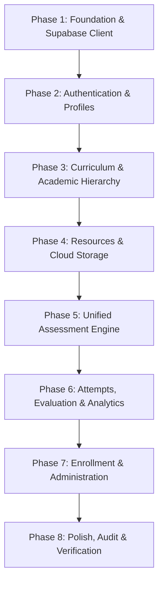

# Medical Competitive Exam LMS — Complete Implementation Plan

## Executive Summary

This document serves as the master implementation plan and architectural roadmap for transitioning the **Sultanat e Italia Medica LMS** from its current client-side prototype into a full-stack, enterprise-grade Learning Management System powered by **React 18 + TypeScript + Vite** on the frontend and **Supabase (PostgreSQL + Auth + Storage + RLS)** on the backend, strictly aligned with [`project_overview.md`](file:///c:/Users/ASUS/Downloads/workspace/project_overview.md) and [`src/db/db.sql`](file:///c:/Users/ASUS/Downloads/workspace/src/db/db.sql).

> [!IMPORTANT]
> **Design & Aesthetic Integrity Guarantee**: All existing design tokens, themes, and branding will be strictly preserved without modification:
> - Deep Navy (`--navy: #0f2b46`, `--navy-light: #1a3a5c`)
> - Medical Teal (`--teal: #0d9488`, `--teal-light: #14b8a6`)
> - Italian Tri-Color Accent Bar (`.italy-accent` with green, white, and red)
> - Mobile-first App Container (`max-width: 430px`), card elevations, typography, and bottom navigation bar

---

## Current Architecture vs. Target Architecture

```
CURRENT PROTOTYPE STATE                             TARGET PRODUCTION STATE
┌─────────────────────────────────┐                 ┌─────────────────────────────────┐
│ React Frontend (Monolithic UI)  │                 │ React Frontend (Feature Modules)│
│                                 │                 │                                 │
│ - src/screens/*.tsx             │                 │ - src/features/{auth,curriculum,│
│ - src/context/DataContext.tsx   │                 │     resources,assessments,...}  │
│   (All state in localStorage)   │                 │ - src/lib/supabase.ts           │
│ - Base64 strings in localStorage│                 │ - Feature-level React hooks     │
└────────────────┬────────────────┘                 └────────────────┬────────────────┘
                 │                                                   │
                 ▼                                                   ▼
┌─────────────────────────────────┐                 ┌─────────────────────────────────┐
│ Browser LocalStorage            │                 │ Supabase Cloud Platform         │
│ (Fragile, 5MB quota limit,      │                 │                                 │
│  no real authorization/RLS)     │                 │ - PostgreSQL (Authoritative DB) │
│                                 │                 │ - Supabase Auth (JWT Sessions)  │
│                                 │                 │ - Supabase Storage (Bucket:     │
│                                 │                 │   'resources' for PDFs/media)   │
│                                 │                 │ - Row Level Security (RLS)      │
└─────────────────────────────────┘                 └─────────────────────────────────┘
```

---

## Database Entity Mapping Matrix

The database schema defined in [`src/db/db.sql`](file:///c:/Users/ASUS/Downloads/workspace/src/db/db.sql) directly powers the application features:

| Table in `db.sql` | Purpose in LMS | Corresponding Frontend Module | Key Role Access |
|---|---|---|---|
| `profiles` | 1:1 user profile tied to `auth.users` | `src/features/auth` | Student, Faculty, Admin |
| `students`, `faculty` | Role-specific academic profiles | `src/features/users` | Student, Faculty, Admin |
| `departments` | Academic/clinical departments | `src/features/curriculum` | Admin, Faculty |
| `exams` | Competitive exams (NEET, IMAT, UCAT, MCAT) | `src/features/curriculum` | All (Read), Admin (Write) |
| `classes`, `batches` | Academic grades & batch cohorts | `src/features/curriculum` | All (Read), Admin (Write) |
| `subjects`, `chapters`, `topics` | 3-tier academic curriculum hierarchy | `src/features/curriculum` | All (Read), Faculty/Admin (Write) |
| `student_exams`, `student_subjects` | Many-to-many student curriculum mapping | `src/features/enrollment` | Faculty, Admin |
| `faculty_subjects` | Faculty subject assignments | `src/features/curriculum` | Admin |
| `resources`, `resource_files` | Learning materials & Supabase Storage files | `src/features/resources` | Student (Read), Faculty/Admin (CRUD) |
| `questions`, `question_options` | Reusable medical question bank & options | `src/features/assessments`| Faculty/Admin (CRUD) |
| `assessments`, `assessment_questions` | DPPs, PYQs, Mock Tests, Test Series | `src/features/assessments`| Student (Read/Take), Faculty/Admin |
| `attempts`, `attempt_answers` | Student assessment runs & answer records | `src/features/attempts` | Student (Own), Faculty/Admin |
| `audit_logs` | Compliance and action logging | `src/features/admin` | Admin |

---

## Phase-by-Phase Implementation Roadmap



---

### Phase 1: Project Foundation & Supabase Client Setup

#### Objective
Connect the frontend to Supabase with strong TypeScript type definitions, environment configuration, and graceful offline/demo fallbacks.

#### What We Have to Build
1. **Environment Configuration (`.env`)**:
   - `VITE_SUPABASE_URL`: Project API URL.
   - `VITE_SUPABASE_ANON_KEY`: Public client anon key.
2. **Supabase Client (`src/lib/supabase.ts`)**:
   - Instantiate the official `@supabase/supabase-js` client.
   - Add connectivity detection and fallback handling to allow seamless local development.
3. **Database Types (`src/types/database.ts`)**:
   - Strict TypeScript definitions mirroring all tables, columns, relationships, and enums from `db.sql`.

#### How We Build It
- Verify environment variables on startup.
- Export a singleton `supabase` client with full TypeScript generic types: `createClient<Database>(url, key)`.
- Create domain type aliases for clean frontend imports (`Profile`, `Exam`, `Subject`, `Resource`, `Assessment`, `Attempt`).

---

### Phase 2: Authentication & Role-Based Profiles

#### Objective
Replace prototype localStorage authentication with real **Supabase Auth** session management and automatic profile creation.

#### What We Have to Build
1. **`AuthContext.tsx` Refactoring**:
   - Integrate `supabase.auth.getSession()`, `supabase.auth.onAuthStateChange()`, `signInWithPassword()`, `signUp()`, and `signOut()`.
   - Load user profile (`profiles` table) on session establishment to resolve the user's role (`STUDENT`, `FACULTY`, `ADMIN`).
   - Retain `isViewingAs` admin emulation feature for development/audit testing.
2. **Login & Registration Flow (`src/screens/AuthScreens.tsx`)**:
   - Keep the existing UI (animated branding, medical icon, Italian accent bar, input styles).
   - Hook form submit to `supabase.auth.signUp()` and insert matching record in `profiles`, `students`, or `faculty`.
3. **Route & Screen Protection**:
   - Ensure role-based routing dynamically directs users to `StudentHome`, `FacultyDashboard`, or `AdminDashboard`.

#### How We Build It
- On `signUp()`, create the `auth.users` row and ensure a matching record is inserted into `profiles` with the selected role.
- If registered as `STUDENT`, create the corresponding `students` entry. If `FACULTY`, create the `faculty` entry.
- Preserve identical visual styles: same gradient headers, loading spinners, and error alerts.

---

### Phase 3: Curriculum & Academic Hierarchy (Exam → Subject → Chapter → Topic)

#### Objective
Transition hardcoded curriculum data into a dynamic 3-tier hierarchy driven by PostgreSQL.

#### What We Have to Build
1. **Curriculum Service & Hooks (`src/features/curriculum/`)**:
   - `useExams()`: Fetch active medical exams (NEET, IMAT, UCAT, MCAT).
   - `useSubjects(examId?)`: Fetch subjects (Physics, Chemistry, Biology) associated with student/faculty.
   - `useChapters(subjectId)`: Fetch ordered chapters for a subject.
   - `useTopics(chapterId)`: Fetch ordered topics within a chapter.
2. **Curriculum Navigation UI**:
   - Interactive subject selector with progress and chapter accordions.
   - Faculty management screens to add/order chapters and topics.

#### How We Build It
- Query PostgreSQL with parent-child joins:
  ```ts
  supabase.from('subjects').select('*, chapters(*, topics(*))').order('display_order', { referencedTable: 'chapters' });
  ```
- Use optimistic React state updates so the UI responds immediately without layout shifts.

---

### Phase 4: Learning Resources & Cloud Storage Integration

#### Objective
Move binary resource handling from Base64 strings in localStorage to **Supabase Storage** (bucket: `resources`), retaining the enhanced document viewer.

#### What We Have to Build
1. **Storage Upload Pipeline**:
   - In `UploadResource`, upload the selected file directly to Supabase Storage:
     `resources/{subject_code}/{chapter_id}/{timestamp}_{filename}`.
   - Insert metadata into the `resources` and `resource_files` tables.
2. **Resource Viewer (`ResourceViewer`)**:
   - Maintain the existing viewers created in our previous task:
     - **PDF Viewer**: Blob URL rendering with fallback and native "Open in Tab / Fullscreen".
     - **TextViewer**: Formatted paper layout with line numbers, copy, and word count.
     - **FileViewer**: Office documents (DOCX, XLSX, PPTX) metadata cards and download streams.
     - **ImageViewer & VideoPlayer**: Media display with watermarks.
3. **Resource Filters & Access**:
   - Filter by Exam Category, Subject, Chapter, and Type (`NOTE`, `BOOK`, `DPP`, `PYQ`, `VIDEO`).
   - RLS automatically restricts unauthenticated or draft resources.

#### How We Build It
- Use `supabase.storage.from('resources').createSignedUrl(storagePath, 3600)` for secure temporary viewing URLs.
- Retain the exact UI cards, badges, and Italien color accents.

---

### Phase 5: Unified Assessment Engine (DPP, PYQ, Mock Tests, Test Series)

#### Objective
Build a shared question and assessment architecture that powers daily practice, previous year question drills, and timed full-length mock examinations.

#### What We Have to Build
1. **Question Bank Management (`questions` & `question_options`)**:
   - Support standard Medical MCQs (4 options, 1 correct), numerical, and assertion-reason questions.
   - Support marks (e.g., +4) and negative marking (e.g., -1).
   - Rich explanations for post-exam review.
2. **Assessment Creator (Faculty)**:
   - Configure title, subject, chapter, type (`DPP`, `PYQ`, `MOCK_TEST`, `TEST_SERIES`), duration (minutes), total marks, and retake policy.
   - Select and order questions into `assessment_questions`.
3. **Interactive Test Runner (Student)**:
   - Timed examination mode with live countdown timer.
   - Question palette (Answered, Marked for Review, Unvisited).
   - Option selection and state persistence during an active attempt.

#### How We Build It
- Reuse a single Assessment Engine component across all test types:
  - **DPP**: Chapter-specific, 10–15 questions, untimed or short timer.
  - **PYQ**: Year-tagged questions, comprehensive solution explanations.
  - **Mock Test / Test Series**: Full syllabus, strict timer, negative marking calculation.

---

### Phase 6: Student Attempts, Automated Scoring & Performance Analytics

#### Objective
Record student exam runs, calculate scores with medical negative marking, and display analytical visualizations using Recharts.

#### What We Have to Build
1. **Attempt Lifecycle (`attempts` & `attempt_answers`)**:
   - `startAttempt()`: Create record with `status: 'IN_PROGRESS'`.
   - `saveAnswer()`: Record student's selected option in real-time.
   - `submitAttempt()`: Calculate total correct, incorrect, unattempted, and final score:
     $$\text{Score} = (\text{Correct} \times 4) - (\text{Incorrect} \times 1)$$
2. **Results Screen**:
   - Score breakdown card, accuracy percentage, time taken.
   - Celebration confetti trigger (`canvas-confetti`) on pass/high score.
   - Question-by-question review showing student's choice, correct answer, and explanation.
3. **Student Performance Analytics (`Recharts`)**:
   - **Score Trend Chart**: Line chart of performance over time.
   - **Subject-wise Accuracy**: Bar chart comparing Physics, Chemistry, Biology.
   - **Weakness Analysis**: Chapters/topics with accuracy < 50%.

#### How We Build It
- Use existing Recharts dependencies (`ResponsiveContainer`, `BarChart`, `LineChart`, `Tooltip`).
- Maintain existing card styles and theme colors (`#0d9488`, `#0f2b46`).

---

### Phase 7: Student Enrollment, Batch Management & Administration

#### Objective
Incorporate the single and multiple student enrollment features into the database and provide platform governance for administrators.

#### What We Have to Build
1. **Batch & Course Enrollment**:
   - Connect [`EnrollStudentsModal.tsx`](file:///c:/Users/ASUS/Downloads/workspace/src/components/EnrollStudentsModal.tsx) to `student_subjects` and `batches`.
   - Allow faculty to enroll single students or bulk-enroll filtered candidate students.
2. **Admin Governance**:
   - Manage user statuses (`active`, `suspended`).
   - Publish, unpublish, or archive resources and assessments.
   - View audit log entries from `audit_logs` table.

#### How We Build It
- Execute bulk inserts into `student_subjects` or `student_exams` via Supabase:
  ```ts
  const records = studentIds.map(student_id => ({ student_id, subject_id }));
  await supabase.from('student_subjects').upsert(records);
  ```

---

### Phase 8: Hardening, Polish, Security Verification & Build

#### Objective
Verify all RLS security policies, validate responsive mobile rendering, and ensure zero-error production builds.

#### What We Have to Build
1. **RLS Security Verification**:
   - Verify students cannot update resources or access other students' attempt answers.
   - Verify faculty can only manage their assigned subjects.
2. **Build & Bundle Validation**:
   - `npm run typecheck` (`tsc --noEmit`) passes with 0 errors.
   - `npm run build` (`vite build`) produces an optimized production bundle.

---

## Target File Directory Structure

```text
src/
├── app/
│   ├── App.tsx                     # Main router and screen controller
│   └── routes.tsx                  # Declarative route configuration
├── components/
│   ├── Navigation.tsx              # Header, BottomNav, SearchBar, StatusBadge
│   └── EnrollStudentsModal.tsx     # Single & Bulk Student Enrollment Modal
├── context/
│   ├── AuthContext.tsx             # Supabase Auth session & role provider
│   └── DataContext.tsx             # Backward-compatible data adapter
├── features/
│   ├── auth/                       # Login, Register, Profile, Role Redirection
│   ├── curriculum/                 # Exams, Classes, Batches, Subjects, Chapters
│   ├── resources/                  # Resource list, upload, Document Viewers
│   ├── assessments/                # DPP, PYQ, Mock Test engine & Question Bank
│   ├── attempts/                   # Exam runner, attempt submission, results
│   ├── analytics/                  # Recharts performance graphs
│   └── admin/                      # User management, audit logs, governance
├── lib/
│   └── supabase.ts                 # Centralized Supabase client instance
├── types/
│   ├── database.ts                 # Full DDL database type definitions
│   └── models.ts                   # Domain models and application types
├── screens/                        # Existing screens (refactored progressively)
│   ├── AdminScreens.tsx
│   ├── AuthScreens.tsx
│   ├── FacultyScreens.tsx
│   ├── QuizScreens.tsx
│   ├── ResourceScreens.tsx
│   └── StudentScreens.tsx
├── index.css                       # Preserved theme tokens and styling
└── main.tsx                        # React application entry point
```

---

## Step-by-Step Execution Checklist

- [x] **Step 1**: Create `src/lib/supabase.ts` and `src/types/database.ts` with types from `db.sql`. *(Completed)*
- [x] **Step 2**: Create `.env.example` and connect project to Supabase. *(Completed)*
- [x] **Step 3**: Migrate `AuthContext.tsx` to Supabase Auth while keeping existing UI intact. *(Completed)*
- [ ] **Step 4**: Wire curriculum data (Exams, Subjects, Chapters) from PostgreSQL.
- [ ] **Step 5**: Wire Resources and connect uploads to Supabase Storage bucket `resources`.
- [ ] **Step 6**: Connect the Assessment Engine and interactive test runner to `assessments` & `questions`.
- [ ] **Step 7**: Connect Attempt submission and evaluation to `attempts` & `attempt_answers`.
- [ ] **Step 8**: Implement Recharts analytics dashboard for students and faculty.
- [ ] **Step 9**: Connect single/multiple student enrollment to `student_subjects` & `batches`.
- [ ] **Step 10**: Verify RLS policies, typecheck, and validate production build.
